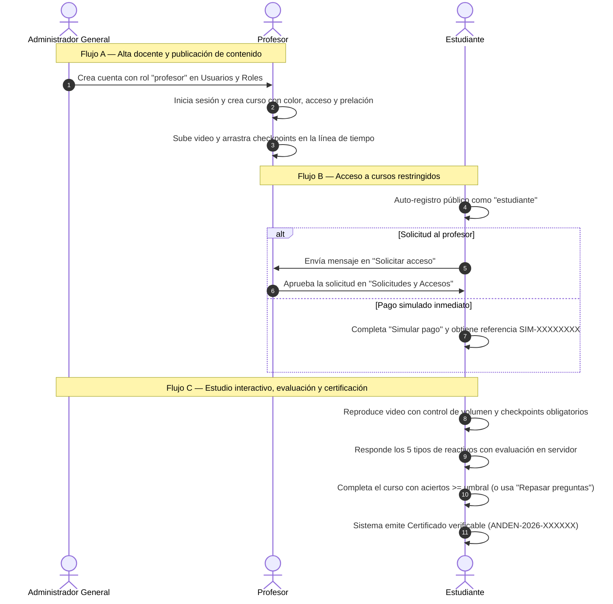

# Manual de Usuario — Plataforma **andén**

> **Proyecto:** Plataforma Interactiva de Microaprendizaje **andén**  
> **Versión del Sistema:** 3.0.0  
> **Fecha de Elaboración:** Noviembre 2026  
> **Asignatura:** Programación Web — Ingeniería en Informática (URBE)  
> **Arquitectura:** Frontend React 18 + Vite | Backend FastAPI + SQLAlchemy 2 + SQLite

---

## Tabla de Contenidos

1. [Introducción y Descripción General](#1-introducción-y-descripción-general)
2. [Instalación, Puesta en Marcha y Cuentas de Demostración](#2-instalación-puesta-en-marcha-y-cuentas-de-demostración)
3. [Entidades, Catálogo Base y Matriz de Permisos por Rol](#3-entidades-catálogo-base-y-matriz-de-permisos-por-rol)
4. [Guía Funcional — Módulo de Estudiantes](#4-guía-funcional--módulo-de-estudiantes)
5. [Guía Funcional — Módulo de Profesores](#5-guía-funcional--módulo-de-profesores)
6. [Guía Funcional — Módulo de Administrador General](#6-guía-funcional--módulo-de-administrador-general)
7. [Sistema de Evaluación, Gamificación, Logros y Certificación](#7-sistema-de-evaluación-gamificación-logros-y-certificación)
8. [Flujos de Interacción entre Roles](#8-flujos-de-interacción-entre-roles)
9. [Referencia Rápida: Rutas y Atajos de Teclado](#9-referencia-rápida-rutas-y-atajos-de-teclado)
10. [Solución de Problemas Frecuentes (Troubleshooting)](#10-solución-de-problemas-frecuentes-troubleshooting)

---

## 1. Introducción y Descripción General

### 1.1 Propósito de la Plataforma

**andén** es una plataforma web interactiva de microaprendizaje orientada al desarrollo de habilidades técnicas y profesionales. Su experiencia está diseñada alrededor de una metáfora ferroviaria: cada **curso** representa una *línea* temática con identidad visual y color propios, y cada **lección** funciona como una *estación* secuencial dentro del recorrido formativo.

A diferencia de los portales de video pasivo, **andén** aplica un modelo de **aprendizaje activo con evaluación continua**:

- **Checkpoints integrados en video:** Los videos se detienen automáticamente en segundos específicos para presentar preguntas interactivas. El estudiante solo puede adelantar hasta el máximo que ya ha visto (y nunca más allá de una pregunta pendiente) hasta completar la lección.
- **Cinco tipos de reactivos con evaluación en servidor:** Opción única, Verdadero/Falso, Múltiple respuesta, Completación y Desarrollo (con auto-evaluación algorítmica inmediata para no interrumpir el aprendizaje).
- **Entorno visual adaptable:** Cada curso o categoría personaliza dinámicamente el color de acento, el fondo del aula, las barras de progreso y el reproductor.
- **Control total de acceso y prelaciones:** Admite cursos gratuitos y cursos restringidos (desbloqueables mediante solicitud al profesor o pago simulado), así como prelaciones opcionales entre cursos.
- **Gamificación y certificación verificable:** Experiencia (XP), niveles, racha real de días consecutivos de estudio, 9 logros dinámicos, árbol de habilidades por categoría y certificados imprimibles con código único verificable vía API.

### 1.2 Alcance del Manual

Este manual documenta todas las pantallas, formularios, controles, validaciones, reglas de negocio y flujos de trabajo verificados directamente sobre la versión 3.0.0 del código fuente. Está dirigido a los tres roles operativos de la plataforma:

1. **Estudiante (`estudiante`):** Explora el catálogo, solicita acceso o realiza pagos simulados en cursos restringidos, cursa lecciones interactivas con checkpoints, consulta su progreso/logros y obtiene certificados.
2. **Profesor (`profesor`):** Crea y administra sus propios cursos (con módulos, lecciones, temas de color y prelaciones), sube videos al servidor, diseña y posiciona checkpoints en la línea de tiempo interactiva y gestiona los accesos a sus cursos restringidos.
3. **Administrador General (`admin_general`):** Dispone de control global sobre todos los cursos y solicitudes de la plataforma, además de la administración exclusiva de cuentas de usuario y asignación de roles (`profesor`, `admin_general`, `estudiante`).

### 1.3 Requisitos Técnicos y Seguridad de Acceso

#### Requisitos del Cliente (Navegador)
- **Navegador moderno:** Google Chrome, Microsoft Edge, Mozilla Firefox, Safari u Opera actualizado, con soporte para JavaScript ES6+, HTML5 `<video>`, Fullscreen API y `localStorage`.
- **Conectividad local o en red:** Acceso HTTP al servidor frontend (puerto por defecto `5182`, que redirige vía proxy las peticiones `/api` y `/uploads`) y al backend FastAPI (puerto por defecto `8000`).

#### Almacenamiento de Datos y Multimedia
- **Base de datos relacional:** Todos los usuarios, cursos, módulos, lecciones, preguntas, inscripciones, progreso, rachas, logros y certificados se persisten en SQLite (`backend/anden.db`) a través de FastAPI + SQLAlchemy 2.
- **Archivos de video:** Los videos precargados se sirven desde `public/videos/` y los videos subidos por profesores se almacenan en `backend/uploads/videos/`, transmitiéndose con soporte **HTTP Range (`206 Partial Content`)** para permitir rebobinado y búsqueda fluida. *(El almacenamiento en IndexedDB del navegador se conserva únicamente como respaldo heredado para referencias con prefijo `idb:`.)*
- **Preferencias locales (`localStorage`):** El navegador guarda el token JWT (`anden-token`), el caché de sesión (`anden-sesion`) y las preferencias del reproductor (`anden-volumen` y `anden-silenciado`).

#### Autenticación y Seguridad
- **Contraseñas:** Se cifran en el servidor con **PBKDF2-HMAC-SHA256** (120 000 iteraciones y *salt* aleatorio por usuario).
- **Sesiones:** Se gestionan con tokens **JWT (HS256)** enviados como cabecera `Authorization: Bearer <token>`, con una vigencia de **7 días**.
- **Auto-registro restringido:** El formulario público de registro asigna obligatoriamente el rol `estudiante`; ningún usuario puede auto-asignarse permisos de profesor o administrador.

> [!NOTE]
> **Política actual de recuperación de contraseñas:** La versión 3.0.0 no dispone todavía de un flujo de recuperación automática por correo electrónico ni de un botón de cambio de contraseña dentro de la interfaz web del panel administrativo. Si un usuario olvida su contraseña, el Administrador General puede desactivar la cuenta anterior y crear una nueva cuenta desde la pestaña **Usuarios y Roles**, o restablecer el hash directamente en la base de datos del servidor.

---

## 2. Instalación, Puesta en Marcha y Cuentas de Demostración

### 2.1 Requisitos de Ejecución Local
- **Node.js** 18+ y **npm** (para el frontend React + Vite).
- **Python** 3.11+ (probado en Python 3.13) con `venv` y `pip` (para el backend FastAPI + SQLite).

### 2.2 Instalación (Solo la Primera Vez)

```powershell
# 1. Instalar dependencias del frontend
npm install

# 2. Crear entorno virtual e instalar dependencias del backend Python
python -m venv backend\.venv
.\backend\.venv\Scripts\pip.exe install -r backend\requirements.txt
```

### 2.3 Inicio de la Plataforma

**Opción recomendada en Windows (PowerShell):**
```powershell
.\iniciar.ps1
```
El script inicia automáticamente el backend FastAPI en el puerto `8000` y el servidor frontend Vite en el puerto `5182`.

**Opción manual (en dos terminales separadas):**
```powershell
# Terminal 1 — Backend FastAPI + SQLite (puerto 8000)
cd backend
.\.venv\Scripts\uvicorn.exe app.main:app --host 127.0.0.1 --port 8000 --reload

# Terminal 2 — Frontend React + Vite (puerto 5182)
npm run dev
```

**Puntos de acceso una vez iniciada la plataforma:**
- **Aplicación web (Frontend):** `http://localhost:5182`
- **Documentación interactiva del API (Swagger UI):** `http://127.0.0.1:8000/docs`
- **Verificación de estado del servidor:** `GET http://127.0.0.1:8000/api/health`

### 2.4 Cuentas de Demostración Precargadas

Al arrancar el servidor con una base de datos vacía, `seed.py` crea automáticamente tres cuentas listas para pruebas (todas con contraseña **`1234`**):

| Rol | Usuario | Contraseña | Nombre en pantalla | Estado inicial precargado |
| :--- | :--- | :--- | :--- | :--- |
| **Administrador General** | `admin` | `1234` | Administrador General | Control global sobre cursos, solicitudes y usuarios |
| **Profesor** | `profe` | `1234` | Prof. Andrés Carvajal | Autor de los 6 cursos iniciales del catálogo |
| **Estudiante** | `diego` | `1234` | Diego Cardozo | 2 340 XP (Nivel 8), racha de 12 días, *PHP desde cero* completado con certificado, acceso aprobado a *Diseño de interfaces* y avance en curso en *Fundamentos de React* |

---

## 3. Entidades, Catálogo Base y Matriz de Permisos por Rol

### 3.1 Entidades Principales del Sistema

| Entidad (Tabla SQLite) | Propósito y Atributos Principales |
| :--- | :--- |
| **Usuario** (`usuarios`) | Identidad y credenciales: `username`, `email`, `nombre`, `primer_nombre`, `iniciales`, `password_hash`, `rol` (`estudiante`, `profesor`, `admin_general`), `activo` y `creado_por_id`. |
| **Curso** (`cursos`) | Línea formativa principal: `titulo`, `categoria`, `nivel`, `descripcion`, `color` (hexadecimal), `tipo_acceso` (`gratis` / `restringido`), `precio`, `umbral_certificado` (10–100 %, por defecto 70 %), `prerequisito_curso_id` y `creado_por_id`. |
| **Módulo** (`modulos`) | Agrupación secuencial de lecciones dentro de un curso (`orden`, `titulo`). |
| **Lección** (`lecciones`) | Estación de aprendizaje con `orden`, `titulo`, `duracion` en segundos (sincronizada automáticamente con la duración real del video) y `video_url`. |
| **Pregunta / Checkpoint** (`preguntas`) | Punto evaluativo incrustado en un `segundo` exacto del video. Guarda `tipo`, `pregunta` y `config_json` (opciones, respuesta(s) correcta(s), pistas, palabras clave, mínimo de palabras y explicación formativa). |
| **Inscripción / Acceso** (`inscripciones_acceso`) | Control de acceso a cursos restringidos por estudiante: `estado` (`pendiente`, `aprobado`, `rechazado`), `metodo` (`solicitud_profesor`, `pago_simulado`, `admin`), `mensaje_solicitud`, `metodo_pago`, `referencia_pago`, `monto_pagado` y `aprobado_por_id`. |
| **Progreso y Respuestas** (`progreso_usuario`, `progreso_lecciones`, `respuestas_usuario`) | Almacena XP total, última lección visitada, rachas de aciertos, segundo máximo visto por lección, estado de finalización y puntaje/intentos de cada pregunta. |
| **Gamificación y Certificados** (`actividad_diaria`, `logros_usuario`, `certificados`) | Registro diario de actividad (fechas ISO) para el cálculo de racha, logros desbloqueados con fecha y certificados con código irrepetible (`ANDEN-AAAA-XXXXXX`). |

### 3.2 Catálogo Inicial Precargado

Al iniciar por primera vez, el sistema dispone de **6 cursos, 18 módulos, 39 lecciones y 106 preguntas interactivas** (incluyendo ejemplos de los 5 tipos de preguntas en las lecciones 102 y 103 de *Fundamentos de React*):

| ID | Título del Curso | Categoría | Nivel | Color | Mód. / Lec. | Acceso | Precio (sim.) | Umbral Cert. | Prelación |
| :-: | :--- | :--- | :--- | :-: | :-: | :--- | :-: | :-: | :--- |
| 1 | Fundamentos de React | Programación | Principiante | `#2f6f73` | 3 / 9 | Gratis | — | 70 % | Ninguna |
| 2 | PHP desde cero | Programación | Principiante | `#6a9c89` | 3 / 6 | Gratis | — | 70 % | Ninguna |
| 3 | Diseño de interfaces | Diseño | Intermedio | `#8e6c8a` | 3 / 6 | Restringido | \$14.99 | 70 % | Ninguna |
| 4 | Bases de datos SQL | Datos | Principiante | `#5b7db1` | 3 / 6 | Restringido | \$19.99 | 70 % | Ninguna |
| 5 | Python para análisis | Datos | Intermedio | `#c77d8e` | 3 / 6 | Restringido | \$24.99 | 75 % | **Bases de datos SQL** |
| 6 | CSS Flexbox y Grid | Diseño | Principiante | `#b08968` | 3 / 6 | Gratis | — | 70 % | Ninguna |

### 3.3 Matriz Comparativa de Permisos por Rol

| Funcionalidad / Módulo | Estudiante | Profesor | Administrador General |
| :--- | :---: | :---: | :---: |
| Auto-registro público desde la pantalla de acceso | Sí | No (lo crea el Admin) | No (precargado o creado por otro Admin) |
| Ver catálogo de cursos y filtrar por categoría y tipo de acceso | Sí | Sí | Sí |
| Reproducir lecciones de cursos gratuitos | Sí | Sí | Sí |
| Solicitar acceso o simular pago en cursos restringidos | Sí | Acceso directo automático | Acceso directo automático |
| Sujeto a bloqueo por prelación de cursos | Sí | Exento (acceso de revisión) | Exento (acceso de revisión) |
| Completar lecciones, responder checkpoints y usar modo repaso | Sí | Sí | Sí |
| Consultar progreso personal, árbol de habilidades y logros | Sí | Sí | Sí |
| Emitir, visualizar e imprimir certificados propios | Sí (si nota ≥ umbral) | Sí (si nota ≥ umbral) | Sí (si nota ≥ umbral) |
| Reiniciar su propio progreso académico | Sí | Sí | Sí |
| Acceder al panel directivo (`/admin`) | No (redirige a `/`) | Sí (*Panel Profesor*) | Sí (*Panel Admin*) |
| Alternar entre Panel Directivo y Vista Estudiante | N/A | Sí (*Ver vista estudiante*) | Sí (*Ver vista estudiante*) |
| Crear nuevos cursos con módulos, lecciones y temas de color | No | Sí | Sí |
| Editar o eliminar cursos creados por su propia cuenta | No | Sí | Sí |
| Editar o eliminar cursos creados por otros profesores | No | No (*Solo lectura*) | Sí (Control total) |
| Subir videos (hasta 250 MB) y calibrar checkpoints en timeline | No | Sí (solo en sus cursos) | Sí (en todos los cursos) |
| Aprobar o revocar solicitudes de acceso | No | Sí (solo en sus cursos) | Sí (en todos los cursos) |
| Habilitar acceso directo manual a estudiantes | No | Sí (solo en sus cursos) | Sí (en todos los cursos) |
| Consultar listado de estudiantes | No | Sí (solo estudiantes) | Sí (todos los usuarios) |
| Crear cuentas con rol `profesor`, `admin_general` o `estudiante` | No | No | Sí |
| Desactivar o reactivar cuentas de terceros | No | No | Sí (excepto su propia cuenta) |

---

## 4. Guía Funcional — Módulo de Estudiantes

### Acción 4.1: Registrarse como Nuevo Estudiante

- **Propósito:** Crear una cuenta personal con rol `estudiante` e ingresar inmediatamente a la plataforma.
- **Paso a paso:**
  1. Abre `http://localhost:5182`. Al no haber sesión activa, aparecerá la pantalla de autenticación.
  2. Selecciona la pestaña **"Crear cuenta"**.
  3. Completa los campos del formulario:
     - **Nombre completo \*** *(Obligatorio)*: Mínimo 2 caracteres (ej. `María Pérez`). El sistema extrae automáticamente el primer nombre y las iniciales para el avatar.
     - **Nombre de usuario \*** *(Obligatorio)*: Entre 3 y 40 caracteres en minúsculas sin espacios; admite letras, números, punto (`.`), guion (`-`) y guion bajo (`_`) (ej. `maria.perez`).
     - **Correo electrónico (opcional)**: Si se ingresa, debe ser único en la plataforma.
     - **Contraseña \*** *(Obligatorio)*: Mínimo 4 caracteres.
     - **Confirmar contraseña \*** *(Obligatorio)*: Debe coincidir exactamente con la contraseña ingresada.
  4. Pulsa **"Crear cuenta y entrar"**.
- **Resultado esperado:** El servidor valida unicidad de usuario y correo, cifra la contraseña con PBKDF2, crea la cuenta con rol `estudiante`, inicializa su registro de progreso en cero, emite un token JWT válido por 7 días y redirige a la pantalla **Inicio** (`/`).

---

### Acción 4.2: Iniciar Sesión y Cerrar Sesión

#### Iniciar Sesión
1. En la pantalla de acceso, sitúate en la pestaña **"Iniciar sesión"**.
2. Introduce tu **Usuario** y **Contraseña**. Puedes pulsar el botón **"Ver"** / **"Ocultar"** dentro del campo de contraseña para comprobar lo que escribes.
3. *(Opcional para pruebas)* Haz clic en uno de los tres botones de **Accesos de demostración** (**Estudiante**, **Profesor** o **Admin general**) para autocompletar las credenciales demo (`1234`).
4. Pulsa **"Ingresar a la plataforma"**.
- **Resultado esperado:** Si eres estudiante, accedes a **Inicio** (`/`). Si eres profesor o administrador general, accedes directamente al panel (`/admin`).

#### Cerrar Sesión
1. En el extremo derecho de la barra superior (**Header**), junto a tu indicador de nivel y avatar, haz clic en el botón **"Salir"**.
- **Resultado esperado:** Se eliminan `anden-token` y `anden-sesion` de `localStorage` y regresas a la pantalla de inicio de sesión.

---

### Acción 4.3: Navegar por la Pantalla de Inicio

- **Propósito:** Retomar el estudio exactamente donde lo dejaste con un solo clic y ver un resumen rápido de tu trayectoria.
- **Comportamiento adaptativo:**
  - **Si eres un estudiante nuevo (sin avance aún):** Muestra el saludo personalizado (*«Empieza tu primera línea de aprendizaje»*), un botón directo para iniciar el primer curso gratuito disponible, enlace al catálogo completo y una vista previa de hasta 4 cursos del catálogo.
  - **Si ya tienes cursos en progreso:**
    1. **Bloque principal (Hero):** Teñido con el color del curso activo, indica *"Te quedaste en"* (o *"Lo que sigue es"*), el título de la lección actual, número de estación (ej. *lección 2 de 9*), el tiempo restante y el botón **"Seguir la lección"**.
    2. **Ruta ferroviaria horizontal:** Línea interactiva con todas las estaciones (lecciones) del curso activo. Las estaciones completadas y la actual son clicables; las pendientes aparecen bloqueadas hasta completar las previas.
    3. **Tus cursos en progreso:** Tarjetas de acceso rápido a todos los cursos que ya comenzaste y aún no finalizas.
    4. **Certificados obtenidos:** Tarjetas con sello (`✪`), porcentaje de aciertos y código único para abrir tus diplomas al instante.

---

### Acción 4.4: Explorar el Catálogo y Filtrar Cursos

- **Propósito:** Descubrir toda la oferta académica, identificar cursos gratis, restringidos o con prelación, y filtrar según tus intereses.
- **Paso a paso:**
  1. Haz clic en **"Cursos"** en la barra de navegación superior (`/cursos`).
  2. Usa la **barra de categorías** superior para filtrar por **Todos**, **Programación**, **Diseño**, **Datos** o cualquier categoría personalizada creada por un docente.
  3. Usa la **barra de tipo de acceso** para filtrar entre **Todos**, **Gratis** o **Restringidos**.
  4. Examina cada tarjeta de curso (`FilaCurso`):
     - Número identificador teñido con el color temático de la línea.
     - Etiquetas de acceso: **Gratis**, **Acceso habilitado**, **Solicitud pendiente** o **Restringido · \$XX.XX**.
     - Etiqueta de prelación (cuando aplica): **Requiere: [Nombre del curso]** (en alerta) o **Prelación cumplida**.
     - Metadatos: categoría, nivel, cantidad de lecciones, duración total estimada y tu porcentaje de aciertos (si ya respondiste preguntas).
     - Barra de porcentaje de avance y botón contextual: **Empezar**, **Continuar**, **Repasar**, **Solicitar acceso**, **Ver solicitud / pagar** o **Completar previo** (además del enlace **Certificado** si ya lo obtuviste).

---

### Acción 4.5: Desbloquear Cursos Restringidos (Solicitud al Profesor o Pago Simulado)

Los cursos marcados como **Restringido** ofrecen **dos vías** dentro de la misma ventana modal (`ModalAccesoCurso`):

#### Opción A — Solicitar Acceso a un Profesor
1. Haz clic en **"Solicitar acceso"** sobre la tarjeta del curso (o desde el aviso de bloqueo si entraste directamente a `/aula/:cursoId`).
2. En el modal, mantente en la pestaña **"Contactar a un profesor"**.
3. Revisa o personaliza el campo **"Mensaje para el profesor o administrador"** *(Obligatorio)*.
4. Pulsa **"Enviar solicitud de acceso"**.
- **Resultado esperado:** La solicitud queda registrada con estado `pendiente` en SQLite. La etiqueta del curso cambia a **"Solicitud pendiente"** y el botón pasa a **"Ver solicitud / pagar"** (permitiéndote también cambiar al pago simulado si no deseas esperar).

#### Opción B — Desbloqueo Inmediato mediante Pago Simulado
1. Abre el modal del curso restringido y haz clic en la pestaña **"Simular pago (\$XX.XX)"**.
2. Selecciona un **Método de pago (simulado)**:
   - `Pago Móvil (demo)`
   - `Tarjeta de débito / crédito (demo)`
   - `Transferencia bancaria (demo)`
3. Verifica o escribe el **Nombre del titular** *(Obligatorio)*.
4. Revisa el *Total simulado* y pulsa **"Confirmar pago simulado y desbloquear"**.
5. Al aparecer la confirmación con tu código de comprobante (ej. `SIM-A1B2C3D4`), haz clic en **"Entrar al curso ahora"** (si la prelación está cumplida) o **"Cerrar"**.
- **Resultado esperado:** No se realiza ningún cobro real; el sistema registra la inscripción como `aprobado` con referencia `SIM-XXXXXXXX` y habilita las lecciones de inmediato.

---

### Acción 4.6: Cumplir Prelaciones de Cursos y Secuencia de Lecciones

- **Prelación entre cursos:** Si un curso tiene configurado un curso prerrequisito (por ejemplo, *Python para análisis* requiere aprobar primero *Bases de datos SQL*):
  - En el catálogo mostrará la insignia **"Requiere: Bases de datos SQL"** y el botón **"Completar previo"**.
  - Si intentas abrir su URL directamente, el Aula mostrará la pantalla **"Prelación requerida"** con un acceso directo para ir al curso previo.
  - Una vez completes el 100 % de las lecciones del curso prerrequisito, el curso siguiente se desbloqueará automáticamente.
- **Desbloqueo secuencial de lecciones:** Dentro de cada curso, las estaciones avanzan en orden:
  - **Completada (`hecho`):** Estación terminada; puedes volver a verla en cualquier momento y adelantar el video libremente.
  - **En curso (`actual`):** Estación habilitada actualmente; muestra tu avance parcial (ej. `0:18 / 1:00`).
  - **Pendiente (`pendiente`):** Estación bloqueada hasta finalizar la estación anterior. Si accedes manualmente a su enlace, verás el aviso **"Lección bloqueada"** con un enlace directo a la lección que debes terminar primero.

---

### Acción 4.7: Reproducir Lecciones y Controlar el Reproductor Interactivo

Al entrar al **Aula** (`/aula/:cursoId/:leccionId`), el entorno completo (fondo suave, borde, insignia de categoría, barras y reproductor) adopta dinámicamente la paleta cromática del curso.

#### Controles del Reproductor Multimedia
1. **Reproducir / Pausar:** Pulsa el botón central **"▶"**, el botón **"▶" / "❚❚"** de la barra inferior, o haz **clic simple** sobre el área del video. *(Deshabilitado mientras haya una pregunta activa en pantalla.)*
2. **Línea de tiempo con control de avance:**
   - La barra tenue indica tu **límite máximo alcanzado**; la barra menta indica la **posición actual**.
   - Los círculos sobre la barra señalan los **checkpoints** (blanco = pendiente, menta = respondido). Al pasar el cursor sobre cada círculo se muestra el segundo exacto y el tipo de pregunta.
   - Puedes retroceder a cualquier segundo previo, pero **no puedes adelantar más allá de lo ya visto ni saltarte un checkpoint pendiente** hasta completar la lección.
   - Si cierras la lección a mitad de camino, al volver el reproductor **reanudará automáticamente** desde el último segundo guardado.
3. **Control de Volumen y Silencio:**
   - **Deslizador de volumen:** Arrastra la barra horizontal de volumen (entre el tiempo y el botón de pantalla completa) para subir o bajar el sonido de **0 % a 100 %** en incrementos suaves de 5 %. Al pasar el cursor muestra el porcentaje exacto.
   - **Botón de silenciar / activar sonido:** Haz clic en el icono de altavoz (o presiona la tecla **`M`**) para silenciar al instante. Al volver a pulsarlo, restaura el último nivel de volumen no nulo que estabas usando.
   - **Indicador visual dinámico:** El icono cambia automáticamente entre silenciado (altavoz con `×`), volumen bajo (≤ 50 %, una onda) y volumen alto (> 50 %, dos ondas).
   - **Persistencia automática:** Tu nivel de volumen y estado de silencio se guardan en el navegador (`anden-volumen` / `anden-silenciado`) y se mantienen al cambiar de lección o recargar la página. Además, el volumen permanece siempre disponible incluso mientras respondes una pregunta.
4. **Modo Pantalla Completa:**
   - Pulsa el icono de marco cuadrado en la esquina inferior derecha, haz **doble clic** sobre el video o presiona la tecla **`F`**.
   - Presiona **`F`** o **`Esc`** para salir. En pantalla completa, las tarjetas de preguntas se superponen centradas con scroll automático para que nunca pierdan legibilidad.

---

### Acción 4.8: Resolver Checkpoints Evaluativos (5 Tipos de Preguntas)

Cuando el video llega al segundo configurado de un checkpoint pendiente, se pausa automáticamente y despliega la tarjeta del **Cuestionario** indicando el segundo, el tipo de reactivo y la recompensa de XP disponible:

1. **Opción única (`opcion_unica`):** Haz clic en la opción correcta (**A**, **B**, **C**…) y pulsa **"Responder"**. Si fallas, la opción errónea queda marcada y deshabilitada para ayudarte a razonar el siguiente intento.
2. **Verdadero / Falso (`verdadero_falso`):** Selecciona **V** (*Verdadero*) o **F** (*Falso*) y pulsa **"Responder"**.
3. **Múltiple respuesta (`multiple_respuesta`):** Marca **todas** las opciones correctas (aparecerá una marca `✓` en cada una) y pulsa **"Responder"**. Si falta alguna opción o sobra alguna incorrecta, el servidor entrega una pista específica sin revelar la solución.
4. **Completación (`completacion`):** Lee la *Pista* (si existe), escribe la palabra o término exacto en el campo de texto y pulsa **"Responder"** (o presiona la tecla **`Enter`**). La evaluación ignora mayúsculas, tildes y puntuación sobrante.
5. **Desarrollo auto-evaluado (`desarrollo`):** Lee la *Guía* (si existe) y redacta tu explicación con tus propias palabras. Observa el contador en vivo debajo del cuadro (ej. `8 / 8 palabras mínimas`). Al pulsar **"Responder"**, el servidor evalúa instantáneamente la extensión mínima y la cobertura de conceptos clave, mostrando los conceptos cubiertos o sugiriendo qué ideas ampliar si aún faltan.

Al acertar, verás la explicación formativa del docente y el botón **"Continuar"** para reanudar el video.

#### Finalización de la Lección
Al llegar al final del video sin checkpoints pendientes, el sistema registra la lección como completada, suma **+50 XP** (y **+150 XP** adicionales si era la última lección del curso) y muestra la pantalla de cierre con:
- **Siguiente lección** (cuando hay más estaciones en el curso), o
- **Ver mi certificado** (si era la última lección y alcanzaste el % mínimo de aciertos), o
- **Volver a cursos** (si terminaste el curso pero aún debes mejorar el % de aciertos), y
- **Ver de nuevo** para reproducir nuevamente el video.

---

### Acción 4.9: Repasar Preguntas para Reforzar o Subir el Porcentaje de Aciertos

- **Propósito:** Volver a responder los checkpoints de una lección ya completada —fundamental si finalizaste un curso con un porcentaje de aciertos menor al mínimo requerido para el certificado—.
- **Paso a paso:**
  1. Abre cualquier lección completada desde el temario lateral del **Aula**.
  2. En el encabezado superior de la lección, pulsa **"Repasar preguntas"** *(aparece solo si la lección está completada y tiene preguntas)*.
  3. Reproduce el video: en modo repaso el reproductor volverá a pausarse en cada checkpoint para que respondas de nuevo.
  4. Al terminar (o en cualquier momento), pulsa **"Salir de repaso de preguntas"**.
- **Resultado esperado:** El servidor actualiza el puntaje de cada pregunta **únicamente si tu nuevo puntaje supera al anterior** (nunca te perjudica ni duplica XP). Si el porcentaje promedio del curso alcanza o supera el umbral configurado, el certificado se emite automáticamente.

---

### Acción 4.10: Consultar Mi Progreso, Árbol de Habilidades y Galería de Logros

#### Mi Progreso (`/progreso`)
Haz clic en **"Mi progreso"** en el Header (o directamente en tu indicador de *Nivel + Avatar*):
1. **Nivel y barra de XP:** Muestra tu nivel actual, XP dentro del nivel (sobre 300 XP), cuántos puntos faltan para el siguiente nivel y tu XP acumulado total.
2. **Cinco indicadores clave:** *Días seguidos estudiando* (racha real), *Lecciones completadas*, *Preguntas acertadas*, *Aciertos promedio* (%) y *Minutos de estudio*.
3. **Certificados y porcentaje de aciertos:** Muestra tus diplomas emitidos y, si terminaste algún curso por debajo de su mínimo aprobatorio, despliega el aviso **"Cursos terminados por mejorar para certificado"** con enlace directo al aula para usar el modo repaso.
4. **Árbol de habilidades dinámico:** Agrupa todos los cursos del catálogo por categoría (*Programación*, *Diseño*, *Datos* y categorías nuevas), indicando el porcentaje y estado de cada nodo (`hecho`, `actual` o `pendiente`). Cada nodo es un enlace directo al curso.
5. **Logros recientes:** Muestra tus últimas 3 insignias desbloqueadas y el contador total con enlace a `/logros`.

#### Galería de Logros (`/logros`)
Haz clic en **"Logros"** en el Header para inspeccionar las **9 insignias del sistema**:
- Los logros obtenidos aparecen iluminados con su **fecha exacta de desbloqueo** en español.
- Los logros pendientes muestran una barra de progreso numérica (`progreso de meta`) que se actualiza en tiempo real con tu actividad.

---

### Acción 4.11: Visualizar, Imprimir y Verificar Certificados

- **Propósito:** Obtener tu diploma oficial al finalizar un curso con nota igual o superior a su umbral mínimo.
- **Paso a paso:**
  1. Accede a tu certificado desde **Inicio**, **Cursos** (enlace *Certificado*), **Aula** (botón *Ver certificado*), el cierre de la última lección o **Mi progreso**.
  2. En la vista `/certificado/:cursoId` se muestra el diploma oficial con: nombre completo del estudiante, título, categoría, nivel, total de lecciones aprobadas, porcentaje de aciertos obtenido vs. mínimo aprobatorio, fecha de emisión y **código único de verificación** (`ANDEN-2026-XXXXXX`).
  3. Pulsa **"Imprimir / Guardar PDF"** para abrir el diálogo de impresión del navegador y generar un PDF limpio (los estilos `@media print` ocultan automáticamente la cabecera, pie de página y botones de acción).
- **Verificación externa de autenticidad:** Cualquier institución o evaluador puede validar un código consultando el endpoint público sin autenticación:
  ```http
  GET http://127.0.0.1:8000/api/certificados/verificar/ANDEN-2026-XXXXXX
  ```
  El servidor responderá con `valido: true`, nombre del estudiante, curso, porcentaje de aciertos y fecha de emisión (o `404` si el código no existe).

---

### Acción 4.12: Reiniciar Progreso Académico

- **Propósito:** Borrar tu historial de aprendizaje personal para volver a cursar la plataforma desde el inicio.
- **Paso a paso:**
  1. Ve a **Mi progreso** (`/progreso`) y desplázate hasta la sección inferior **"Tu avance guardado en el servidor"**.
  2. Haz clic en **"Reiniciar progreso"**.
  3. En la confirmación en línea (*«¿Seguro que deseas reiniciar tu progreso? Volverás al punto de partida.»*), pulsa **"Sí, estoy seguro"** (o **"No, cancelar"**).
- **Resultado esperado:** El servidor elimina tus lecciones completadas, respuestas, racha diaria, logros y certificados en SQLite. *(Nota especial de demostración: para la cuenta `diego`, el reinicio restaura automáticamente su semilla inicial de prueba; para todas las demás cuentas, el progreso vuelve íntegramente a cero.)*

---

## 5. Guía Funcional — Módulo de Profesores

Al iniciar sesión con una cuenta de rol `profesor`, accedes directamente al **Panel de Profesor** (`/admin`), que contiene **tres pestañas**: **Cursos**, **Videos y Checkpoints** y **Solicitudes y Accesos**.

> [!TIP]
> **Alternar entre Panel y Vista Estudiante:** En la esquina superior derecha del panel dispones del botón **"Ver vista estudiante"**, que te permite recorrer `/cursos`, `/aula`, `/progreso` y `/logros` con acceso sin restricciones (sin pago ni prelación) para probar tus lecciones tal como las ven los alumnos. Para regresar al panel, haz clic en **"Panel Profesor"** en la barra superior.

---

### Acción 5.1: Crear un Nuevo Curso

- **Propósito:** Publicar un curso propio con estructura de módulos/lecciones, tema visual, tipo de acceso, umbral de certificación y prelación opcional.
- **Paso a paso:**
  1. En la pestaña **"Cursos"**, utiliza el formulario izquierdo **"Agregar nuevo curso"**.
  2. Completa los campos:
     - **Título del curso \*** *(Obligatorio)*: Entre 2 y 80 caracteres.
     - **Categoría**: Elige `Programación`, `Diseño`, `Datos` o `Otra categoría…` (si eliges esta última, escribe el nombre en **Nombre de la categoría \***). Al cambiar de categoría se sugiere un color coherente automáticamente.
     - **Nivel**: `Principiante`, `Intermedio` o `Avanzado`.
     - **Descripción \*** *(Obligatorio)*: Entre 3 y 300 caracteres.
     - **Tipo de acceso**: `Gratis (abierto a todos)` o `Restringido (permiso admin / pago simulado)`.
     - **Precio simulado (USD)** *(Solo si es Restringido)*: Valor numérico ≥ 0 (por defecto `15`).
     - **Prelación / curso prerrequisito (opcional)**: Selecciona otro curso existente que el alumno deba completar primero, o deja `Ninguno`.
     - **% mínimo de aciertos para certificado**: Número entero entre `10` y `100` (por defecto `70`).
     - **Color y ambiente del curso**: Selecciona una de las 6 muestras de color o usa el selector de color nativo. Observa en la columna derecha la tarjeta **"Vista previa del tema"** actualizándose en tiempo real.
     - **Módulos y lecciones**:
       - Edita el título del módulo inicial y pulsa **"+ Módulo"** para añadir más módulos (o **"Quitar"** si hay más de uno).
       - Escribe el título de cada lección y usa **"+ Agregar lección"** (o **`×`** para quitar).
       - **Duración automática:** No debes ingresar duración manual; las lecciones nuevas muestran la etiqueta **`Auto`** y su duración exacta se calcula automáticamente al cargar su video en la pestaña *Videos y Checkpoints*.
  3. Haz clic en **"Crear curso"**.
- **Resultado esperado:** El curso queda registrado en SQLite asignado a tu usuario (`creado_por_id`) y aparece inmediatamente en el catálogo y en la lista **Cursos actuales**.

---

### Acción 5.2: Buscar, Editar y Eliminar Cursos Propios (Aislamiento Docente)

- **Búsqueda rápida:** En la tarjeta **"Cursos actuales"** de la columna derecha, escribe en el campo **"Buscar curso…"** para filtrar por título o categoría.
- **Regla de propiedad docente:** Cada curso muestra el nombre de su autor (`Autor: ...`).
  - En **tus propios cursos**, verás activos los botones **"Editar"**, **"Videos"** y **"Eliminar"**.
  - En **cursos creados por otros profesores**, se mostrará la etiqueta **"Solo lectura · otro profesor"**; el backend también bloquea cualquier intento de edición, subida de video o eliminación externa con HTTP `403 Forbidden`.
- **Editar un curso propio:**
  1. Pulsa **"Editar"** en el curso deseado; el formulario izquierdo cambiará a **"Editar curso"** con los datos precargados (las lecciones con video mostrarán su duración real `MM:SS`).
  2. Realiza los cambios y pulsa **"Guardar cambios"** (o **"Cancelar edición"**).
  3. El sistema valida que no selecciones el mismo curso como prerrequisito ni generes una prelación circular entre dos cursos.
- **Eliminar un curso propio:**
  1. Pulsa **"Eliminar"**; el botón cambiará a **"Confirmar"** como medida de prevención.
  2. Pulsa **"Confirmar"** para eliminarlo definitivamente (en cascada junto con sus módulos, lecciones y preguntas, desvinculando cualquier prelación que apuntara a él).

---

### Acción 5.3: Subir Videos y Calibrar Checkpoints en la Línea de Tiempo Interactiva

- **Propósito:** Cargar o reemplazar archivos multimedia reales en el servidor Python y colocar visualmente preguntas de cualquiera de los 5 tipos sobre la barra del video.
- **Paso a paso:**
  1. Abre la pestaña **"Videos y Checkpoints"** (o pulsa el botón **"Videos"** en cualquiera de tus cursos desde la pestaña *Cursos*).
     > [!NOTE]
     > El selector **Curso \*** lista únicamente tus cursos editables. Si eres un profesor nuevo y todavía no has creado ningún curso, verás un aviso invitándote a crear tu primer curso en la pestaña **Cursos**.
  2. Selecciona el **Curso \*** y elige el **Destino del video**:
     - **Editar lección existente:** Selecciona la **Lección \*** deseada (se cargan automáticamente su video actual y sus checkpoints existentes).
     - **Crear nueva lección:** Escribe el **Título de la nueva lección \*** y elige el **Módulo** de destino.
  3. **Cargar o reemplazar video:** Haz clic o arrastra un archivo a la zona de carga (*Dropzone*).
     - Formatos admitidos: `.mp4`, `.webm`, `.ogg`, `.mov`, `.mkv`.
     - Tamaño máximo permitido: **250 MB**.
     - Al seleccionarlo (o al editar una lección con video existente), se carga de inmediato el reproductor de vista previa (con controles nativos de reproducción y volumen) y se detecta automáticamente la duración real del video.
  4. **Posicionar preguntas con la Línea de Tiempo Interactiva (`TimelineCheckpoints`):**
     - **Clic en la barra:** Mueve el fotograma del video al segundo elegido y actualiza el contador `Posición: MM:SS / MM:SS`.
     - **Botón `+ Poner pregunta en MM:SS`:** Crea un nuevo checkpoint exactamente en la posición actual del video.
     - **Arrastrar marcadores (`#1`, `#2`…):** Mantén presionado y desliza cualquier marcador sobre la pista para cambiar su segundo en vivo mientras ves el fotograma correspondiente en el video.
     - **Botón `Mover #N aquí`:** Reubica el checkpoint seleccionado a la posición actual de la aguja del video.
     - También puedes ajustar manualmente los campos `min` y `seg` dentro de cada tarjeta o pulsar **"+ Agregar pregunta"**.
     - Si un marcador supera la duración real del video (`segundo >= duracion`), se resaltará en rojo y el sistema impedirá guardar hasta corregirlo.
  5. **Configurar cada pregunta:**
     - Elige el tipo en el desplegable (`Opción única`, `Verdadero / Falso`, `Múltiple respuesta`, `Completación` o `Desarrollo (auto-evaluado)`).
     - Redacta el **Enunciado de la pregunta \***.
     - Configura las respuestas según el tipo:
       - *Opción única:* De 2 a 6 opciones; marca el botón radial de la correcta.
       - *Verdadero / Falso:* Marca si la afirmación es Verdadera o Falsa.
       - *Múltiple respuesta:* De 2 a 6 opciones; marca todas las casillas correctas (mínimo 1).
       - *Completación:* Lista las **Respuestas aceptadas** separadas por coma y añade una **Pista** opcional.
       - *Desarrollo:* Lista las **Palabras clave para auto-evaluación** separadas por coma y fija el **Mínimo de palabras** (mínimo 3, por defecto 8).
     - Agrega opcionalmente una **Explicación formativa al aprobar**.
  6. Pulsa **"Guardar video y checkpoints"**.
- **Resultado esperado:** Si adjuntaste un archivo nuevo, se sube mediante `POST /api/videos/upload` a `backend/uploads/videos/`; luego se guarda la duración real detectada y todos los checkpoints ordenados cronológicamente en SQLite.

---

### Acción 5.4: Gestionar Solicitudes y Otorgar Accesos Manuales (Cursos Propios)

En la pestaña **"Solicitudes y Accesos"** (la pestaña muestra entre paréntesis la cantidad de solicitudes pendientes):

#### Aprobar o Revocar Solicitudes Existentes
1. En la columna derecha **"Solicitudes y pagos simulados"**, revisa las tarjetas de tus cursos (se muestra nombre y `@usuario` del alumno, estado `pendiente` / `aprobado` / `rechazado`, curso, método, referencia `SIM-...` si aplica y mensaje del estudiante).
2. Pulsa **"Aprobar"** para conceder acceso inmediato, o **"Revocar"** para denegar o retirar el acceso.
3. Puedes pulsar **"Actualizar"** en cualquier momento para recargar la lista desde el servidor.

#### Habilitar Acceso Directo Manual
1. En la columna izquierda **"Otorgar acceso directo a un estudiante"**, selecciona al **Estudiante** registrado.
2. Selecciona uno de tus cursos en **Curso restringido**.
3. Pulsa **"Habilitar acceso"**.
- **Resultado esperado:** El estudiante recibe acceso inmediato (`estado: aprobado`, `metodo: admin`) sin necesidad de haber enviado solicitud ni realizado pago simulado.

---

## 6. Guía Funcional — Módulo de Administrador General

El **Administrador General** (`admin_general`) hereda todas las capacidades del módulo de Profesores con **alcance global** sobre toda la plataforma, más la pestaña exclusiva **"Usuarios y Roles"**.

### Acción 6.1: Administración Global de Cursos, Videos y Solicitudes
- En **Cursos** y **Videos y Checkpoints**, todos los cursos de la plataforma —sin importar qué profesor los haya creado— aparecen editables (con botones **Editar**, **Videos** y **Eliminar** habilitados).
- En **Solicitudes y Accesos**, el administrador visualiza y puede aprobar, revocar u otorgar acceso manual sobre **todos los cursos restringidos** del sistema, quedando trazabilidad de auditoría (`aprobado_por_id`).

### Acción 6.2: Crear Cuentas de Profesor, Administrador o Estudiante
- **Propósito:** Dar de alta nuevos docentes o administradores (única vía habilitada en el sistema para roles con privilegios).
- **Paso a paso:**
  1. Abre la pestaña **"Usuarios y Roles"**.
  2. En la tarjeta izquierda **"Crear cuenta de Profesor o Administrador"**, completa:
     - **Nombre completo \*** *(Obligatorio)*: Mínimo 2 caracteres (ej. `Prof. Laura Medina`).
     - **Usuario \*** *(Obligatorio)*: De 3 a 40 caracteres (`a-z`, `0-9`, `.`, `-`, `_`).
     - **Rol \*** *(Obligatorio)*:
       - `Profesor (gestiona cursos, videos y accesos)`
       - `Administrador general (control total)`
       - `Estudiante`
     - **Correo (opcional)**: Correo único institucional o personal.
     - **Contraseña inicial \*** *(Obligatorio)*: Mínimo 4 caracteres.
  3. Haz clic en **"Crear cuenta"**.
- **Resultado esperado:** La cuenta se guarda con contraseña cifrada en SQLite vinculada al administrador (`creado_por_id`) y aparece de inmediato en **Usuarios registrados**.

### Acción 6.3: Desactivar o Reactivar Cuentas de Usuario
- **Propósito:** Suspender el acceso a una cuenta sin perder su historial ni sus cursos creados, o restaurarla posteriormente.
- **Paso a paso:**
  1. En la columna derecha **"Usuarios registrados"** de la pestaña **Usuarios y Roles**, ubica la cuenta deseada (verás nombre, `@usuario`, insignia de rol, correo y etiqueta roja **Inactivo** si está suspendida).
  2. Pulsa **"Desactivar"** (en cuentas activas) o **"Reactivar"** (en cuentas inactivas).
- **Protección contra autobloqueo:** El botón se oculta para tu propia cuenta y el servidor rechaza con HTTP `400` cualquier intento de desactivar o cambiar el rol del administrador actualmente autenticado.
- **Efecto inmediato:** Si un usuario desactivado intenta iniciar sesión, el sistema lo bloquea con el mensaje: *«Esta cuenta se encuentra desactivada. Contacta al administrador.»*, y cualquier token previo deja de ser aceptado.

---

## 7. Sistema de Evaluación, Gamificación, Logros y Certificación

### 7.1 Reglas de Experiencia (XP) y Niveles

| Evento | Experiencia otorgada | Regla de aplicación |
| :--- | :---: | :--- |
| Acertar un checkpoint al **1.er intento** | **+20 XP** | Solo la primera vez que se aprueba la pregunta |
| Acertar un checkpoint en **2.º intento o posterior** | **+5 XP** | Solo la primera vez que se aprueba la pregunta |
| Completar una lección completa | **+50 XP** | Una sola vez por lección |
| Completar todas las lecciones de un curso | **+150 XP** | Bono adicional al terminar la última lección pendiente |
| Repasar una pregunta o lección ya completada | **0 XP** | Mejora el puntaje/aciertos sin duplicar XP |

$$\text{Nivel} = \left\lfloor \frac{\text{XP total}}{300} \right\rfloor + 1$$

Cada nivel requiere **300 XP** para ascender al siguiente.

### 7.2 Cálculo del Porcentaje de Aciertos y Auto-Evaluación

- **Preguntas objetivas** (*Opción única*, *Verdadero/Falso*, *Múltiple respuesta*, *Completación*):
  - 1.er intento: **100 %** (`1.00`)
  - 2.º intento: **65 %** (`0.65`)
  - 3.er intento o posterior: **35 %** (`0.35`)
- **Preguntas de Desarrollo (auto-evaluación en servidor):**
  1. Verifica que el texto alcance el mínimo de palabras configurado (`minPalabras`, mínimo 3, por defecto 8).
  2. Normaliza el texto (sin tildes, minúsculas, sin puntuación) y comprueba la presencia de al menos el **50 %** redondeado hacia arriba ($\lceil 0.5 \times N \rceil$) de las palabras clave definidas por el docente.
  3. Si aprueba, calcula el puntaje base según cobertura de conceptos:
     $$\text{Puntaje base} = 0.75 + 0.25 \times \frac{\text{palabras clave encontradas}}{\text{total de palabras clave}}$$
     y aplica el factor de intento (`1.00` en 1.er intento, `0.85` en 2.º intento, `0.75` en 3.er+ intento).
- **Porcentaje de aciertos del curso:** Es el promedio redondeado de los puntajes obtenidos en todas las preguntas respondidas del curso. Si un curso se completa sin preguntas configuradas, obtiene `100 %`.
- **Emisión del certificado:** Se emite automáticamente (con código `ANDEN-AAAA-XXXXXX`) cuando se cumplen dos condiciones simultáneas: **100 % de lecciones completadas** y **porcentaje de aciertos ≥ umbral del curso** (por defecto 70 %). Si el alumno mejora su porcentaje mediante *Repasar preguntas*, el certificado se actualiza con la nota más alta.

### 7.3 Catálogo Completo de los 9 Logros Dinámicos

| Ícono | Título del Logro | Condición de Desbloqueo | Meta |
| :-: | :--- | :--- | :-: |
| ★ | **Primer paso** | Completar tu primera lección | 1 lección |
| ▲ | **Una semana seguida** | Mantener una racha de estudio diaria consecutiva | 7 días |
| ✓ | **Sin fallar** | Acertar preguntas consecutivas al primer intento | 10 preguntas seguidas |
| ◆ | **Fin de línea** | Completar todas las lecciones de un curso | 1 curso |
| ✪ | **Certificado obtenido** | Aprobar un curso superando su porcentaje mínimo de aciertos | 1 certificado |
| ● | **Un mes seguido** | Mantener una racha de estudio diaria consecutiva | 30 días |
| ✦ | **Explorador** | Comenzar distintos cursos del catálogo | 5 cursos |
| ■ | **Nivel 10** | Alcanzar el nivel 10 acumulando experiencia (2 700 XP) | Nivel 10 |
| ♦ | **Todas las ramas** | Completar todos los cursos presentes en el árbol de habilidades | 100 % de cursos |

### 7.4 Racha Diaria y Árbol de Habilidades
- **Racha diaria (`diasSeguidos`):** Cada día que el estudiante registra avance en un video, responde un checkpoint o completa una lección se guarda la fecha en `actividad_diaria`. La racha cuenta los días consecutivos hasta hoy (o hasta ayer para no perderla antes de estudiar hoy).
- **Árbol de habilidades:** Se construye dinámicamente agrupando los cursos existentes por su categoría (`Programación`, `Diseño`, `Datos`, etc.). En cada rama, cada curso aparece como `hecho` (completado), `actual` (en progreso o siguiente pendiente recomendado) o `pendiente`.

---

## 8. Flujos de Interacción entre Roles



---

## 9. Referencia Rápida: Rutas y Atajos de Teclado

### 9.1 Mapa de Rutas de la Aplicación

| Ruta (URL) | Vista | Roles con acceso |
| :--- | :--- | :--- |
| `/` | **Inicio** (Estudiantes) o **Panel Directivo** (Profesor / Admin) | Todos (autenticados) |
| `/cursos` | Catálogo de cursos con filtros por categoría y acceso | Todos |
| `/aula` | Redirige automáticamente a la lección pendiente para continuar | Todos |
| `/aula/:cursoId/:leccionId` | Aula virtual con reproductor, checkpoints y temario | Todos (sujeto a acceso/prelación en estudiantes) |
| `/progreso` | Nivel, XP, estadísticas, certificados, árbol de habilidades y reinicio | Todos |
| `/logros` | Galería completa de los 9 logros dinámicos | Todos |
| `/certificado/:cursoId` | Diploma oficial imprimible / exportable a PDF | Todos (si el curso está aprobado) |
| `/admin` | Panel de Profesor (3 pestañas) o Panel Admin General (4 pestañas) | Profesor y Admin General *(Estudiante redirige a `/`)* |

### 9.2 Atajos de Teclado y Gestos del Reproductor

| Contexto | Tecla o Gesto | Acción |
| :--- | :--- | :--- |
| Área del video | **Clic simple** | Reproducir o pausar el video *(inactivo durante una pregunta)* |
| Área del video | **Doble clic** | Entrar o salir de pantalla completa |
| Reproductor | **`F`** | Alternar pantalla completa |
| Reproductor | **`Esc`** | Salir de pantalla completa |
| Reproductor | **`M`** | Silenciar o activar sonido (restaura el último volumen) |
| Reproductor enfocado o en pantalla completa | **`↑` / `↓`** | Subir o bajar el volumen en pasos de 10 % |
| Deslizador de volumen enfocado | **`←` / `→`** o **`↑` / `↓`** | Ajustar el volumen en pasos de 5 % |
| Pregunta de Completación | **`Enter`** | Enviar respuesta inmediatamente |
| Timeline del Panel Docente | **Clic en pista / Arrastrar `#N`** | Mover fotograma / reubicar segundo exacto del checkpoint |

---

## 10. Solución de Problemas Frecuentes (Troubleshooting)

| Síntoma o Mensaje en Pantalla | Causa más probable | Solución recomendada |
| :--- | :--- | :--- |
| *«No se pudo conectar con el servidor Python (FastAPI). Verifica que el backend esté encendido en el puerto 8000.»* | El servidor `uvicorn` no está en ejecución o usa otro puerto. | Inicia el backend con `.\iniciar.ps1` o `uvicorn app.main:app --host 127.0.0.1 --port 8000` dentro de `backend/`. |
| *«Tu sesión venció o no es válida. Vuelve a iniciar sesión.»* | Expiró el token JWT (7 días) o se reinició la clave secreta del servidor. | Cierra sesión (o recarga) e ingresa nuevamente con tu usuario y contraseña. |
| *«Esta cuenta se encuentra desactivada. Contacta al administrador.»* | El Administrador General desactivó la cuenta desde *Usuarios y Roles*. | Solicita al Administrador General que pulse **"Reactivar"** en tu perfil. |
| *«Lección bloqueada. Primero termina [Nombre].»* | Intentaste entrar a una lección pendiente antes de concluir la estación previa. | Haz clic en el enlace de la lección actual y visualiza el video hasta el final respondiendo todos sus checkpoints. |
| *«Prelación requerida — Completa primero [Curso].»* | El curso tiene un curso prerrequisito aún incompleto. | Completa el 100 % de las lecciones del curso previo indicado para habilitar el acceso automático. |
| *«Certificado aún no disponible»* tras completar el curso | El porcentaje de aciertos del curso es inferior al mínimo exigido (ej. 70 % o 75 %). | Entra a las lecciones del curso, activa **"Repasar preguntas"** y responde correctamente al primer intento para elevar tu promedio. |
| *«No se pueden agregar preguntas fuera de los límites del propio video.»* | Algún checkpoint tiene un `segundo` igual o mayor a la duración real del video. | Arrastra el marcador rojo hacia la izquierda en la línea de tiempo (o reduce sus segundos) antes de guardar. |
| *«Formato no soportado»* o *«El video supera el límite de 250 MB.»* | Archivo con extensión distinta a `.mp4/.webm/.ogg/.mov/.mkv` o peso mayor a 250 MB. | Convierte o comprime el video a formato `.mp4` (H.264/AAC) por debajo de 250 MB. |
| *«Solo puedes modificar o gestionar los cursos que tú creaste.»* | Un Profesor intentó editar un curso perteneciente a otro Profesor. | Edita únicamente tus propios cursos o solicita la modificación a un Administrador General. |
| *«Prelación circular detectada entre ambos cursos.»* | El curso A exige al curso B y el curso B exige al curso A. | Retira la prelación de uno de los dos cursos antes de guardar. |
| El video se reproduce sin sonido | El reproductor quedó silenciado o el volumen está en `0 %`. | Pulsa el icono de altavoz (o la tecla **`M`**) y desliza la barra de volumen hacia la derecha. |
